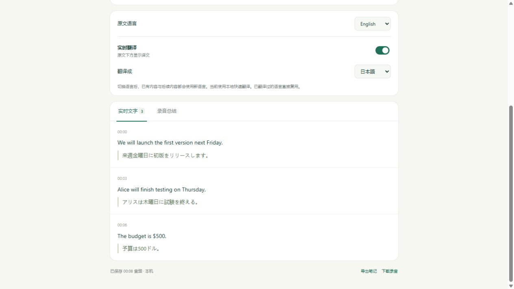

# CodexRecorder

[中文安装与使用指南](README.zh-CN.md) · [Installation](#quick-start-on-windows) · [User guide](docs/USAGE.md)

## Install by pasting this into Codex

Open **Codex in local mode on Windows**, then copy this prompt. Codex needs permission to run local commands and install files; a regular ChatGPT web chat cannot install software on your PC.

```text
Install https://github.com/zhuoqiliu1225-oss/CodexRecorder on this Windows PC.
Read its README, check Python 3.11+, Node.js 18+, Git and Codex CLI, and install missing prerequisites from official sources. Reuse existing installations and never overwrite an unrelated folder.
Clone the complete project into a suitable persistent folder, run scripts/setup.ps1 and scripts/install_skill.ps1, then run node scripts/control.cjs serve and open the returned URL in the Codex side browser without starting recording.
Let me complete any sign-in or system permission prompts. Do not ask for an API key. Explain that initial downloads and cold-start warm-up take time; wait for engine.status to become ready before confirming readiness, without repeatedly starting the service. Finish by showing me how to use the installed $codex-recorder skill to start, pause and stop recording, and open the user guide.
```

The first install downloads speech weights and about **500 MB** of translation weights. Keep the downloaded project folder: the personal skill points to it. If a newly installed skill does not appear, start a new Codex chat. Microphone access is requested only when you start recording.

> **Allow time for the first download and warm-up.** After dependencies are installed, the first service start may still download the speech model, load both models, and warm them up. Slow connections or CPU-only devices may take minutes or longer. Wait while the panel says “Loading and warming up speech model…”; it is ready when it shows “GPU transcription” or “Local CPU transcription” and enables Record. Restarting the PC or background service requires loading and warm-up again, usually without downloading cached models.

The personal skill is available in new chats in other projects; explicitly invoke `$codex-recorder` if needed. The background service keeps models warm for subsequent starts; the first start after a reboot still loads them. Transcript display groups default to about one minute (30 seconds and two minutes are also available) while recognition continues on short audio chunks. Selecting and copying transcript text excludes timestamps; live redraws wait while a text selection is active.

---

Record voice and meetings, watch a live transcript with translation, and get a summary — from a Codex side panel on Windows.

[中文说明](README.zh-CN.md) · [Validation & latency measurements](docs/validation.md)

**Preview 0.2 · Windows first · No API key required**

CodexRecorder combines a repo-scoped Codex skill, a local Python service, and a microphone-enabled panel in the Codex in-app browser. It is a source preview, not an installer or a native MCP App.

## What works

- Chinese and English interface languages, with immediate switching and a saved preference. Interface language is independent of spoken and translation languages; it does not translate saved transcripts or summaries.
- Fixed-height transcript and summary viewports, with a steady recording indicator so live processing does not resize the page.
- Start, pause, resume, and stop recording from the panel or through the Codex skill.
- Incremental local transcription, GPU auto-detection, and rolling context that revises unfinished phrases.
- Local translation between Chinese, English, Japanese, Korean, French, German, and Spanish.
- Change the target language during or after recording: previous text is translated too; future text uses the new selection. Previously translated languages are cached.
- Automatic summaries through your own signed-in Codex CLI, with Markdown notes, JSON transcripts, and WAV audio export.
- Audio and local inference stay on your computer. No API key or separate API billing setup is needed. Codex account eligibility and usage limits still apply to GPT features.



## Quick start on Windows

**Recommended: paste the installation prompt above into a local Windows Codex chat.** For manual installation:

1. Prepare Windows, Python 3.11+, Node.js 18+, Git, and the official Codex CLI signed in with ChatGPT. If only the desktop app is installed, ask Codex to locate its bundled CLI. A regular ChatGPT web chat cannot start a local microphone application.
2. Open PowerShell in a folder where you want to keep the application, then clone the full repository. Alternatively, use GitHub **Code → Download ZIP**, extract it, and enter the folder containing `README.md`, `app`, and `scripts`. Downloading only the skill folder is insufficient.

```powershell
git clone https://github.com/zhuoqiliu1225-oss/CodexRecorder.git
cd CodexRecorder
```

3. Check prerequisites and sign-in. If not signed in, run `codex login` and finish the official sign-in flow; no API key is required.

```powershell
python --version
node --version
git --version
codex login status
```

4. Install dependencies and register the personal skill for use across local projects.

```powershell
.\scripts\setup.ps1
.\scripts\install_skill.ps1
```

Setup installs Python packages in `.venv` and downloads about 500 MB of local multilingual translation weights. The default `base` speech model downloads on first start. Model downloads require internet access; local transcription and translation do not require an API key.

5. Start the service and let it warm up. This does not start microphone recording.

```powershell
node scripts/control.cjs serve
node scripts/control.cjs status
```

Ask Codex to open the returned address in its side browser. Wait for `engine.status` to be `ready`; keep the service and page open during the first download or warm-up, rather than repeatedly running `start`. Run `status` again when you want to check readiness.

6. Send `$codex-recorder Start recording` in Codex and manually allow the microphone when prompted. Start speaking once the panel says “Recording” and the timer increases. If the skill is not visible yet, open a new chat; the personal skill can also be used in new chats in other local projects.

**Installation is ready when** the engine is ready, the side panel opens, and the personal skill can be discovered. GPT summary generation also depends on Codex sign-in, network access, and account limits.

The installer writes a small skill and an installation pointer under your personal `.agents/skills` directory; it keeps the application in the cloned folder. It refuses to overwrite an unrelated existing skill.

Alternatively, open this repository as a local project in Codex. Ask:

> Start recording and translate into English.

Or explicitly invoke the repository's `$recorder`. Codex runs the local controller and opens the panel in its in-app browser. Allow microphone access when prompted. Copying the repository skill folder alone is not an installation; use the personal installer above.

Manual alternative:

```powershell
node scripts/control.cjs start
```

Open the returned URL (`http://127.0.0.1:18764/`) in the Codex in-app browser. The controller does not open an external browser automatically.

```powershell
node scripts/control.cjs pause
node scripts/control.cjs resume
node scripts/control.cjs stop
node scripts/control.cjs status
```

A stop command requests the panel to stop; wait for `processing` or `complete` before treating recording as finished. Keep the panel open while recording.

## Translation and latency

The live path uses local speech recognition and local M2M100 translation. GPT is used for the final summary. If local translation is not installed, compatible language pairs can use an existing local adapter or fall back to Codex, which may take tens of seconds.

Change the target language at any time. Old-language requests are cancelled or ignored, existing text is retranslated, and cached translations appear without a new inference request. Summary generation runs separately so it cannot block language switching.

On one RTX 5070 Laptop GPU, an 8-second synthetic English clip fed to the local service at realtime speed produced its first text at **2.78 s** and first local translation at **2.86 s**. Retranslating three existing rows took **0.31 s**; returning to a cached language took **0.02 s**. These are fixture measurements, not guarantees for arbitrary devices or microphone sessions. See [methodology and limitations](docs/validation.md).

Live text may be revised as more audio arrives. Processing messages stay outside individual paragraphs so status changes do not move the reading area.

## Configuration

Copy or edit `local.settings.json` using [settings.example.json](settings.example.json) as a reference. Local settings are ignored by Git.

- `model`: a faster-whisper model name or a local model directory.
- `device`: `auto`, `cpu`, or `cuda`. CUDA initialization failures fall back to CPU.
- `cuda_library_dirs`: existing CUDA/cuDNN library directories on Windows. Only the service process PATH is updated.
- `multilingual_model`: local M2M100 CT2 directory, normally `models/m2m100`.
- `codex`: the Codex CLI executable name or path.

GPU inference requires compatible CUDA/cuDNN libraries; see [faster-whisper GPU requirements](https://github.com/SYSTRAN/faster-whisper#gpu). CPU mode remains available, but larger speech models may not keep up with live audio.

To skip the multilingual model download, use `scripts/setup.ps1 -SkipTranslationModel`. Configure an existing model manually or expect slower Codex translation.

## Data and privacy

Recordings are stored under `data/<session-id>/`:

- `audio.wav`: received microphone audio.
- `session.json`: text, timings, translation caches, processing state, and diagnostics.
- `notes.md`: transcript, selected translations, and summary.
- `chunks/`: saved PCM blocks used by the recognition queue.

Audio is not uploaded to OpenAI. Local translation stays on the machine. **Transcript text is sent to OpenAI when generating a GPT summary or using GPT translation fallback**, through the user's official Codex CLI login. The application does not read or copy authentication tokens.

The service binds to `127.0.0.1`, validates request origin and a per-process token, and does not log request bodies. This does not turn a local desktop application into a hardened multi-user service.

Models, recordings, logs, screenshots from private sessions, machine settings, and build archives are excluded from Git. The README screenshot uses synthetic speech only.

## Development

The unit tests use only Python's standard library; no model download, account, or microphone is needed:

```powershell
.\.venv\Scripts\python.exe -m unittest discover -s tests -v
node --check web/panel.js
node --check web/i18n.js
node --check web/pcm-worklet.js
node --check scripts/control.cjs
node tests/test_panel.cjs
node tests/test_i18n.cjs
.\.venv\Scripts\python.exe scripts/package.py
```

Optional local model and HTTP checks are documented in [docs/validation.md](docs/validation.md). GitHub Actions runs the standard-library tests and JavaScript syntax checks on Windows with Python 3.11 and 3.12.

The source ZIP in `dist/` excludes recordings, model weights, and personal settings. It is not a standalone EXE.

## Current limits

- Windows is the verified host. iOS, a native MCP App, and a standalone installer are future work.
- Forced window boundaries, noise, accents, and overlapping speakers can still cause transcription errors. There is no speaker identification.
- The small local translator prioritizes speed and may be less accurate than GPT on nuanced text. Not every language or hardware configuration has been systematically evaluated.
- Keep the browser panel and local service running. A lost panel connection ends the session after a timeout; the last unsent audio can be lost during crashes or power failure.
- Restarts recover the latest saved record, with a warning for interrupted work. They do not automatically restart the microphone.
- Having a ChatGPT account alone does not guarantee that the installed Codex CLI can run GPT requests.

Third-party model and dependency sources are listed in [THIRD_PARTY_NOTICES.md](THIRD_PARTY_NOTICES.md). Their licenses remain separate from this repository's code.
